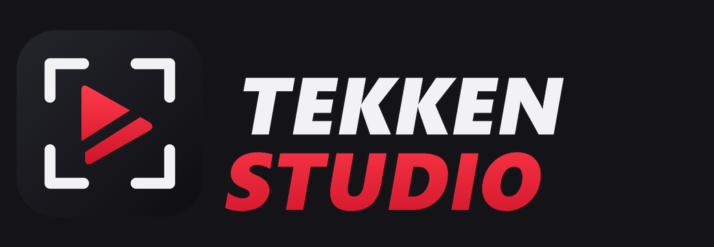
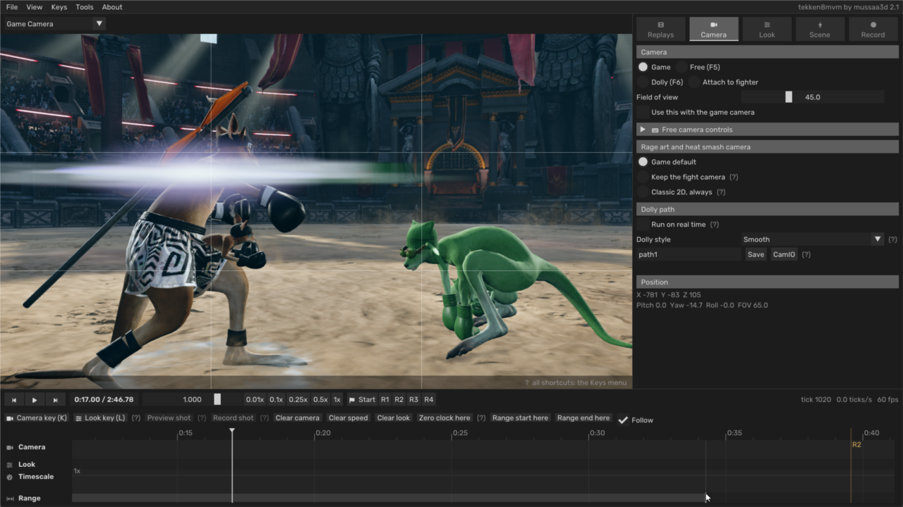
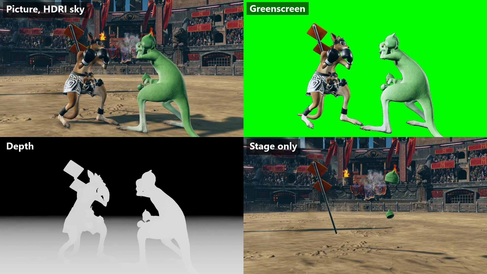
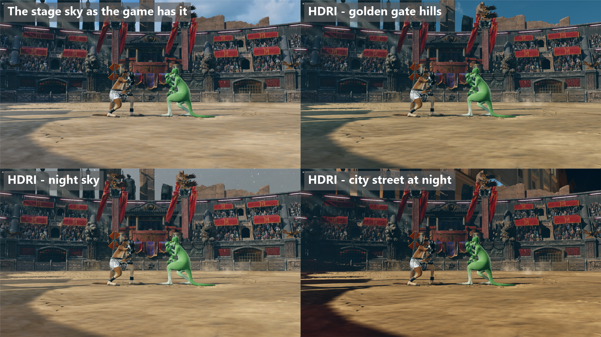

# Tekken Studio (beta v0.1)

Cinematic and movie-making tools for **Tekken 8** on PC, in the spirit of CoDMVM, HLAE and IWXMVM. Offline only.

> **This is an early-access beta, version 0.1.** Most of it is tested in the real game, but expect rough edges and things that break after a game patch. Please report what goes wrong in [Issues](../../issues).

## Legal
Tekken Studio (tekken8mvm) is an unofficial fan-made tool. It isn't made, endorsed or supported by Bandai Namco Entertainment, and TEKKEN is their trademark. It contains no game files and no game code: you need your own copy of Tekken 8 on Steam. Mods for the game may be against its terms of use, and Bandai Namco lists unauthorized mods among its ban reasons, so use it at your own risk and only offline (see [Bans and anti-cheat](#bans-and-anti-cheat)). It's free software under the GNU GPL v3, with no warranty of any kind (see [LICENSE](LICENSE)).

## What it can do

- **A full editor inside the game** (Insert): a timeline with the replay's real frames, rewinding to any frame in under a second, pause, frame step and slow motion down to 0.05x with cloth and hair slowing too.
- **Cameras:** a free camera, dolly paths with keyframes (Smooth, Linear and CoDMVM styles) that show in the picture and can be dragged and turned while the replay plays, as in IWXMVM, a camera attached to a bone, fighter POV, and export to HLAE CamIO for After Effects or Blender.
- **Recording:** frame-locked video through ffmpeg (H.264, H.265, ProRes or PNG) at any size up to 8K, whatever your monitor, with real motion blur and a separate audio pass.
- **Streams for compositing:** picture, greenscreen, stage only, fighters on black, depth and effects on black, all lined up frame for frame.
- **Look:** colour, depth of field, fog, lighting, the sun and sky, your own HDRI sky, graphics presets, HUD presets, a plain stage and any aspect ratio, all keyable over a shot. ReShade's effects show in the editor and can be keyed too.
- **Scene:** actors (copies of a fighter playing motion recorded from a replay), eight lights of your own, any of the game's meshes as props and any of its particle effects.
- **Replays:** change replay from inside the editor, play replays from older game versions, share replays as files with friends, and keep snapshots of your saves.
- **Skins:** choose pak mods per session; they're only in the game folder while the session runs.

Tested in the real game on version 3.02.02 (Steam build 25221600) and 3.03.01 (Steam build 26155785), on replays and through real mouse and keyboard input. What wasn't tested is listed under [Not verified](#not-verified).

## What's in it
The editor (Insert) is laid out like Iris Studio's: the game picture on the left under a strip that says which camera it's from, the tabs Replays, Camera, Look, Scene and Record on the right, and the playback bar and a keyframe timeline along the bottom.

- **Actors** (Scene tab): an actor is a copy of a fighter, body and clothes as they are in this fight, that plays a take somewhere on the stage.
  - **A take** is one fighter's motion over a stretch of the replay. Drag the range on the timeline over it, name it, choose P1 or P2 and press **Record a take**. The replay goes to the start of the range, plays it at normal speed and stops at the end. Takes are saved in `tekken8mvm\takes`, so they're there next time. A take can be up to two minutes.
  - **Add an actor,** give it a take, and it stands where the fighter stood when the take began. **Place** and **Turn** are where the take's first frame goes, **Here** brings it in front of the camera, and **Size** makes it bigger or smaller, steps included.
  - **Its pose comes from the fight clock.** It starts at **Starts at**, plays at **Speed**, and at the end holds its last pose, loops or disappears. So it's in the same pose at the same moment however you got there: scrubbing, rewinding, slow motion, and every pass of a recording. Its bar on the timeline's Scene lane shows when it plays, and dragging the bar moves its start.
  - **In the recording looks an actor counts as a fighter:** it's on the greenscreen, the depth and Fighters on black, and gone from Stage only.
  - Up to six at once. A take plays on a fighter with the same body, so on the character and outfit it was recorded from. For only actors in the picture, hide P1 and P2 (Look > Stage).
- **Lights** (Scene tab): eight lights of your own. **Here** puts one where the camera is, pointing the way it looks, and leaves it there. Each can follow a fighter or stay put, be a point or a spot light, and has brightness, reach, colour and shadows. A spot light has a cone, and points its own way or at a fighter.
- **Props** (Scene tab): any mesh the game has, as a prop with a place, a turn and a size. **+ Add a prop** puts one a little in front of the camera. The list is what this stage has loaded, with a search box. A full path, like `/Game/Stage/Asset-Library/Mob/Animal/Animal_alpaca/SM_Animal_alpaca.SM_Animal_alpaca`, loads a mesh from anywhere in the game's files, another stage's or a pak mod's included. A prop can follow a fighter. Fighters don't bump into props.
- **Effects** (Scene tab): any particle effect the game has loaded (hit sparks, auras, smoke, the stage's own), placed where you like, with a size. With **Runs on the timeline** on, its age comes from the fight clock, counted from its start: it stands still while paused, rewinds with the replay and is at the same age at the same moment. Off, it plays on the game's own time, and **Restart** starts it over.
- **Any picture size** (Record tab, Picture size):
  - **Render size** is the size the game draws at while it records: the game window as it is, 720p up to 8K, or your own numbers. It can be bigger than the monitor. The game is put in a window of that size for as long as the recording runs, and gets its own window back afterwards, where it was, on whichever monitor it's on. It works from a window and from borderless.
  - **Video size** is the size of the file. Rendering big and writing smaller gives cleaner edges than rendering at the small size.
  - Every stream is that size, the depth and greenscreen included.
- **ReShade** (Look tab), if you have [ReShade](https://reshade.me) in the game: its techniques have ticks and the settings of the effects that are on have sliders, in the editor. They're kept in look keys, so an effect can change over a shot. With ReShade there, recordings are taken after its effects, so the video has them. ReShade goes in the game's `Win64` folder, for DirectX 12. The link is built on ReShade 6.8's add-on API and steps down for an older ReShade, as far back as API version 12. If ReShade's own Add-ons page doesn't list tekken8mvm, use the ReShade build with full add-on support.

- **Timeline:** the replay's real frame count, with camera keys, a timescale curve, the recording range, round markers, and the live tick and tick rate.
- **Rewinding:** click anywhere on the ruler and the replay goes there, back or forward, to the exact frame, in under a second. A moment looks the same however you got to it.
- **Preview shot:** goes to the first camera key, flies the path and stops on the last key.
- **Record shot:** the same, recording from the first key's exact frame to the last key's.
- **Round buttons:** R1, R2, R3 and so on beside the timescale jump straight to a round of the replay.
- **Streams:** several files at once that line up frame for frame: picture, greenscreen (green or blue), stage only, fighters on black, depth, effects on black. Every look also shows on screen, so you can see it before recording.
- **Depth:** the game's real depth buffer as a smooth grey picture with clean silhouettes, near things white and far things dark. Near, far and curve sliders set how it falls off.
- **Speed ramps:** ease between timescales by dragging keys on the curve.
- **Free camera:** fly, look, roll and zoom, while the fight runs or is paused.
- **Attached camera:** fix the camera to a bone, orbit it, or watch it from wherever you fly.
- **Fighter POV:** look out of either fighter's eyes (CAMERA > Attach to fighter > Style: Fighter POV). Their head is hidden so it doesn't fill the picture, and you can keep the horizon level.
- **Lighting, stage and frame** (Look tab), after [TekkenOverlay](https://github.com/TekkenOverlay/TekkenOverlay)'s display settings and simplified stages, rebuilt here:
  - **Lighting:** switch the stage's lights off (the sun included), take the key light off the fighters, or colour the light on them. The fighters' light is mostly a colour the stage's `BP_CharacterLightController` puts on their materials, so the tint goes through that and touches only the fighters.
  - **Quality:** global illumination (none, Lumen, screen space), reflections, their quality, shadow quality and anti-aliasing. The x beside one puts the game's own back.
  - **Stage:** a plain stage, every stage mesh in the engine's grey material, and no camera shake.
  - **Frame:** the game's own shape, fill the screen with no black bars, or any fixed aspect ratio, which the recording keeps: 16:9, 21:9, 32:9, 2.39:1 for a cinema look, or 9:16 and 10:16 portrait for TikTok, Reels and Shorts. **Keep the fighters where they are** (on by default) makes the field of view follow the shape, for the game's camera, the free camera and the dolly path alike: the fighters keep the size and place they have in 16:9, a wider shape shows more of the stage at the sides, and a portrait one is the middle of the 16:9 picture. For portrait, **Fit** goes from that (same size, so fighters far apart can leave the sides) to the whole 16:9 width (everything in, smaller). **Record at** sets the render size to the shape, such as 5040 x 2160 for 21:9 or 2160 x 3840 for 9:16, so the video is the full shape with no bars; on screen you see it with bars. **HUD** says what the game's HUD does with the shape: *As the game draws it* leaves it over the whole window; *In the picture* (the default) puts it inside the picture, as small as it comes out in a recording of that shape; *Laid out for the shape* spreads it to the picture's edges, so in portrait the health bars and timer go to the top and the wins and the button bar to the bottom, and in a wide shape the input lists and wins go to the sides.
- **Replay display (Look tab):** hide or show the game's replay panels from the editor, straight away and with no menus: command history, health numbers, the combo counter, attack info, frame info and frame advantage. Each row can also be left to the game's own setting.
- **Only the in-battle status:** tick **Hide the HUD** and **Keep the in-battle status** (HUD and screen) to clear everything except the hit combo, damage, counter, clean, punish and tornado text. Each of those has its own tick under Replay display.
- **Sun and sky** (Look tab): turn the stage's sun and raise or lower it, so the light and shadows move, and turn the sky.
- **A sky of your own (HDRI):** tick **Sky picture of your own**, press **Open the pictures folder**, drop a panorama in (`.hdr` and `.exr` are real HDRIs; `.png` and `.jpg` work too) and pick it. It goes on the stage's own sky, with a brightness slider, and **Light the stage from it** makes the stage's sky light take its light from your picture. The sun stays the stage's: turn it with the sliders to match your picture. A stage with no sky of that kind says so and keeps its own.
- **Look keys:** **+ Look key (L)** on the timeline keeps everything as it is at that moment: every VISUALS setting, the lights, props, effects and actors of the Scene tab, the attached camera (its bone offset, orbit and POV), the field of view used with the game's camera, the depth look, and ReShade's effects. With two or more, sliders, colours, places, turns and sizes move from one key to the next as the replay plays, so the sun, the sky rotation, fog, a light, a prop or an actor can move over a shot, and switches such as Hide the HUD change at the key. Drag a key to move it, right-click to delete it, and to change one, go to it, change the settings and add a key again. A key leaves alone any light, prop, effect or actor it doesn't mention, so one you add after making your keys stays. They're saved with a shot. The camera path and the playback speed have lanes of their own, and the recording setup isn't part of a look.
- **Hide a fighter:** **Hide P1** and **Hide P2** (Stage group) take a fighter out of the picture, shadow included. Their hit sparks still show.
- **Undo:** Ctrl+Z and Ctrl+Y undo and redo your settings, camera path and speed ramp, up to 64 steps. **File > Reset the mod** puts every setting back to how it starts.
- **From the camera:** the depth stream now starts at the camera (Depth near 0), autofocus has **From the camera**, and **Fog starts at the camera** thickens the fog only with distance from you.
- **Rule of thirds:** guides over the picture (View menu), never in a recording.
- **No slow motion on big hits and KOs** (Time group) runs straight through the moments where the game almost stops the fight, so the action carries on with no pause. The replay clock skips ahead with them, so a camera path jumps by that much at those moments.
- **Change replay from inside a replay** or from the game's replay list: in the Replays tab, pick one and press **Play this replay**, or double-click it. It makes the calls the game's own screens make when you click them, so it doesn't press keys or move the mouse, works with the game in the background, and finds the replay by its date and players however the list is sorted. About 10 seconds from the list, a little longer from inside a replay.
- **Time control:** pause, frame step and slow motion down to 0.05x, with poses blended between the game's 60 Hz steps. Clothes, people, plants and the stage slow and stop along with the fight: at 0.05x a jacket strap moves at 0.05 speed. In very deep slow motion cloth moves in small hops rather than a perfect glide (several a second at the slowest speeds), because its solver comes apart in slices shorter than 1/480 s of fight time. Rewinding to a moment gives the same clothes every time.
- **Dolly paths:** keyframes on the timeline in three styles: Smooth, Linear and CoDMVM. A key can turn the camera further than half a circle, and the path goes the way you turned. Save, load, and export HLAE CamIO for After Effects or Blender.
- **The path in the picture** (after [IWXMVM](https://github.com/reallyluckyy/IWXMVM)'s dollycam): with any camera but the dolly itself, the path is drawn over the picture as a yellow line, with a little camera at each key looking the way the key looks and a white dot where the dolly is at this moment. Click a key's camera to pick it: arrows move it along its own ahead, right and up (or the stage's X, Y and Z), and rings turn its pitch, yaw and roll. Double-click it, or use the buttons at the picture's top left, to switch between them. It all works while the replay plays, so you can fix a shot as you watch it, and **From the view** gives the key the camera's place as it is now. To take over in the middle of a shot, press F5 during Preview shot: the free camera starts where the path had it, and K adds a key at that moment. Camera tab > **Camera keys** steps to the key before or after this moment and has every number of the picked key. View > Camera path in the picture hides it. None of it is ever in a recording.
- **Rage art and heat smash camera:** keep the normal fight camera through cinematics and big-hit zooms, or use a fixed classic 2D camera all fight.
- **Effects:** hide hit sparks and glows, cancel rage art screen effects, hide the HUD (and the game's FPS counter).
- **Visuals:** Filmtweaks-style colour, depth of field with autofocus, lens effects, fog in a colour you pick that covers the map's own haze and mist, sun and sky, and sliders for engine settings. Add your own in `tekken8mvm\dvars.ini`.
- **Recording:** frame-locked video through ffmpeg (H.264, H.265, ProRes 422 HQ, ProRes 4444 or PNG). Smooth however slowly it renders.
- **Motion blur:** real blur from averaging 2 to 64 renders per frame, with a shutter angle.
- **Audio pass:** captures only the game's sound to a WAV at 1x, since frame-locked video has none.
- **Presets and shots:** save a look, or a whole shot with its camera path and speed ramp. Both hold the lights, props, effects and actors too. A shot names its takes, so send the `.t8take` files along with it.
- **Skins:** choose pak mods per session. They're only in the game folder while the session runs.
- **Replay sharing:** export a replay to a file, send it to a friend, and they load it. No servers involved. Export the replay you're watching, or straight from the game's own replay list with **Export Replay** in a replay's box.
- **Replay vault:** snapshot your own saves on this PC, tagged with the game build, and restore them.

## Install
Download `tekken-studio-0.1-setup.exe` from this repo's [Releases](../../releases) and run it. It installs over an older version. It installs for your Windows account only, so it doesn't ask for administrator rights, in `%LOCALAPPDATA%\Programs\tekken-studio`, with a Start menu shortcut. Its one dependency is [ffmpeg](https://ffmpeg.org), for recording. The installer downloads ffmpeg 9.0.2 (about 110 MB) from the [GyanD builds](https://github.com/GyanD/codexffmpeg/releases/tag/9.0.2) on GitHub and checks its SHA-256 before using it. Untick that to use an ffmpeg already on your PATH. Nothing else is needed: the tool carries its own runtime, and DirectX 12 comes with Windows.

Or take `tekken-studio-0.1-portable.zip` from the same page: the tool on its own, with no installer. Unzip it anywhere and run `tekken-studio.exe`. It keeps its settings, skins and replay vault in its own folder. For recording it needs ffmpeg on your PATH, or an `ffmpeg` folder next to it with `bin\ffmpeg.exe` inside.

The installer isn't signed, so Windows SmartScreen may say it's from an unknown publisher (More info > Run anyway). Uninstalling (Windows Settings > Apps) takes the mod out of the game folder first, and leaves your recordings, skins and saved replays.

## Use
1. Start **Tekken Studio** from the Start menu (or run `dist\tekken-studio.exe` from a build).
2. In Steam, choose **Steam > Go Offline**.
3. Click **Start cinematic session**. Keep the launcher open: it cleans up when the game closes.
4. In the game, open a replay: **Replay > My Replays & Tips**, then pick one.
5. In the replay's own menu (B), set the three tips (punishment, high moves, throws) to **Hide**, or the replay stops at every tip.
6. Press **Insert** for the editor.

To make a shot: pause, go to a moment on the ruler, press F5 and fly the camera, press K for a key, move along the timeline, and add more keys. Then press **Preview shot** to watch it and **Record shot** to record it.

To put an actor in it: drag the timeline's range over a few seconds of a fighter moving, open the Scene tab and press **Record a take**. When it's done, press **+ Add an actor**, pick the take, fly the camera to where you want it and press **Here**.

While the editor is open it has the keyboard, and the game gets none of it. With the editor closed every key goes to the game (Escape opens its menu and so on), and Insert is the only key the mod listens for. The free camera flies only from the editor. Closing the editor also lifts its pause (unless it's recording), since the game's own controls can't move a game the editor holds still.

| Key (editor open) | Does |
|---|---|
| Insert | Open or close the editor |
| Space or F8 | Play and pause |
| Left, Right | Back and forward 1 s (Shift 5 s, Ctrl 1 frame) |
| `,` `.` | Back and forward 1 frame |
| Up, Down, or `[` `]` | Faster, slower |
| Home | The very start of the replay, intro included |
| Ctrl+Z, Ctrl+Y | Undo, redo |
| F4 | Free camera looks with the mouse or the arrow keys |
| F5 | Free camera |
| F6 | Play dolly path |
| F7 | Record |
| F9 | Hide the HUD |
| K | Add a dolly key (free camera on) |
| L | Add a look key |

With the free camera looking with the arrow keys (F4), the arrows look around, and `,` `.` move along the timeline. The editor's **Keys** menu lists all of these.

Free camera: `WASD` fly, `Q` `E` down and up, hold right mouse over the picture to look, `Shift` faster, `Ctrl` slower, `F4` switches looking between the mouse and the arrow keys, wheel or `Z` `C` roll, `R` level, `Ctrl`+wheel or `+` `-` zoom, `Shift`+wheel sets speed.

**View > Hide hit labels and frame data** hides the words that pop up on hits (Counter and so on) and the frame data panel, which the game draws as one widget. The effects, health bars and input list stay.

**Mods** (Replays tab) lists your own pak mods and switches them off and on while the game runs, through the game's own pak manager. Whatever is already loaded, like HUD pictures, stays until the game loads it again. A mod you switch off stays off the next time the game starts, until you switch it back on there.

The **Effects on black** stream keeps only the fight's particle effects (sparks, trails, smoke, and anything a fighter carries as an effect, like Bryan's weapon) on black, with the stage and fighters hidden. Turn on the depth stream next to it for a matching depth pass. Effects behind a fighter show through, since the fighter isn't there to hide them.

A paused editor stops the game's own menus too, including the one at the end of a replay. Unpause (Space or F8 in the editor) if a game menu stops responding.

## Sharing replays
**Your own replays are saved as files by themselves.** Every replay of your own in the game's list goes into `my_replays` (next to your recordings) as a `.t8replay`, once, named after its date and players, with the game version it was really played on. Online matches are played without the mod (it stays off online and that doesn't change), so an online match is saved the next time you start a cinematic session, a few seconds after the game has loaded its replays: the first session saves the whole list. While a session runs, the list is looked at every few seconds, so a replay the game adds then is saved too. A fight already in the folder isn't saved again, and downloaded replays aren't saved. It's on unless you untick *Export my replays on their own* in the launcher's Replays tab or the editor's. To save one by hand, use **Export this replay** in the editor or **Export Replay** in the game's own list.

**The replay saver, for normal and online play.** *Save my replays while I play, online too* in the launcher's Replays tab puts a small mod of its own in the game folder (`dinput8.dll`, from the `replay-saver` folder), and it stays there like a pak mod until you untick it. While you play, ranked included, it saves each of your replays into `my_replays` a few seconds after the game adds it to its list, the same way a session does. It only reads the game's replay list and writes files: no hooks, nothing written into the game, nothing blocked or sent, and it stops by itself if reading ever faults. For a cinematic session the launcher sets it aside like any other mod's `dinput8.dll` and puts it back when the game closes. It can't share the game folder with another mod's `dinput8.dll`. **Bandai Namco's stated ban reasons include unauthorized mods. Using it online is your choice and your account's risk.**

In the editor's Replays tab, press **Export this replay** while a replay plays, or pick one in the list and press **Export**. Or, in the game's own **Replay** list, open a replay and choose **Export Replay**: it takes the place of the greyed-out *Show P2 Profile*, which can't be used offline anyway. With no name typed, the file is named after the date and the players, like `2026-03-23 03-24-33 Jin vs Bryan.t8replay`. The `.t8replay` file goes in `shared_replays` next to your recordings. Send it to a friend. They add it in the launcher's **Replays** tab with **Add replay files...** (or drop it on the launcher's window, or put it in that folder themselves), before the game is open or while it runs. Once a session starts, every file in the folder goes into the game's **Replay > Downloaded Replays** by itself, a few seconds after the game has loaded its own replays, and a file added while the game runs is picked up within seconds. A replay that's already in the list is skipped. If that screen is open when one comes in, leave it and come back. To load them by hand instead, untick *Load them into the game on their own* in the launcher and press **Load** in the editor's Replays tab.

- A replay from an older version of the game plays when *Play replays from older versions* is ticked (it is unless you untick it). A replay holds the players' button presses, which are played through this version's moves, so if a patch changed a move they used, the fight can play out differently from the real match. A file from a newer version than yours doesn't load.
- The file holds both players' names.
- Loading only changes the game's memory, so the replay is gone when you close the game, unless the game itself saves that group of replays, which happens when you download or delete a replay nearby. Since the files are loaded again every session, they're there every time anyway. Your existing replays aren't touched.

The game keeps every replay decoded in fixed slots in memory, so sharing copies a slot. Nothing is decrypted by Tekken Studio and no save file is edited.

## Tekken Tag Tournament 2 (BlueSpark)
The launcher's **TTT2** tab puts the studio into Tekken Tag Tournament 2 running on [BlueSpark](https://github.com/avim2/BlueSpark), the fan-made native PC port of the Xbox 360 game. You need BlueSpark's play test installed and built once with its own Start Here, and your own copy of the game, as BlueSpark asks. This part is newer and rougher than the Tekken 8 side.

1. Paste your BlueSpark play test folder into the TTT2 tab. It must be BlueSpark release 23 (4.7.4): the studio names things inside BlueSpark's prebuilt library and in the game's code, and those move between releases.
2. Press **Install the studio**. A window builds `ttt2-studio.exe` in `rex\out\build\tekken-studio`, with the compiler BlueSpark's own install already downloaded. It takes under a minute. BlueSpark's own `ttt2.exe` and its files are not changed. After a BlueSpark update, install again.
3. **Watch replays (simple)** or **Open the studio** starts that copy of the game. It is offline only: the studio's copy starts without BlueSpark's sign-in, matchmaking, uploads and update check. Play online with BlueSpark's own Start Here.

**Replays.** BlueSpark already records every offline Versus match and every online match as a `.ttt2replay` in `rex\userdata\replays`, so Tekken Studio doesn't record its own: it uses those. Matches you play online in BlueSpark show up in the studio's copy, since both read the same folder. BlueSpark's **REPLAYS** tab lists them and A watches one; the studio's Replays tab lists the same files.

**Simple mode** is BlueSpark's replay viewer with the studio's bar at the bottom. **Studio mode** is the editor, with the look of the Tekken 8 one. **Insert** switches between the two and **Home** hides the bar. What the studio does there:
- **Time:** pause (Space), slow motion at 0.5x, 0.25x, 0.1x and 0.05x, and frame steps (the full stop), in replays, Practice and offline fights. Slow motion is the game's real frames shown slower.
- **Camera:** a free camera (F5, right mouse button to look, WASD and Q/E to move, the wheel for field of view), and camera keys on a timeline with a path through them (K adds a key, F6 plays the path). The path and its keys are drawn in the picture, with arrows to drag each key. Paths save to and load from files.
- **Recording (F9):** a video at 60 frames a second in `Videos\tekken8mvm`, the size of the window or of the picture's shape. **With the game's sound** (the default) it records in real time: the game plays as it is and its picture and its own sound are saved together, nothing else on the PC in it. Without sound it's frame for frame: the game is run one frame at a time and each picture taken, so every game frame is in the video exactly once however slow the PC is, and at a slow speed each frame is written several times. While it records the studio draws nothing and BlueSpark's hints are off. It needs ffmpeg: the one Tekken Studio's installer downloads is used, or one on your PATH.
- **HUD** (the Camera tab): the game's own, clean (health bars, timer and portraits), health bars and timer, health bars only, timer only, or none. **The HUD follows the shape:** with a shape on, the whole HUD is drawn inside it, as big as fits (in portrait it's the full 16:9 HUD across the middle of the cut, as in Tekken 8; in 21:9 and 32:9 it sits in the middle of the wide frame), and the mode's label goes with it. **HUD place** moves it up to the top of the shape or down to the bottom. **HUD size** makes it bigger than fits, its outer ends running off the sides while the timer and the inner ends of the bars grow.
- **Picture shape** (the Camera tab): 16:9, 21:9, 32:9, 2.39, 9:16 and 10:16. The fighters stay where the 16:9 picture has them: the field of view follows the shape, so 21:9 and 32:9 show more of the stage at the sides, and 9:16 and 10:16 are the middle of the picture, for TikTok, Reels and Shorts. **Fit** widens a portrait view until it holds everything 16:9 did. On screen the rest is covered with bars, and a recording is the shape itself. The game always draws 16:9, so a shape is a cut of that picture: 21:9 from a 1920 x 1080 window is 1920 x 822, and a portrait cut (675 x 1080 for 10:16) is brought up to 1080 wide in the video.
- **BlueSpark's own overlay** (its button hints, its SELECT pill and its Practice boxes) is taken off while the editor is open over a fight, and comes back when the editor closes.

What it doesn't do:
- **Sound needs real time.** A recording with sound is what the PC manages to show, so a PC that can't hold 60 frames a second gives a video with repeated frames. The frame-for-frame kind is exact, and silent.
- **Recording takes the picture off the screen,** so the game's window has to stay in front and uncovered, and the video is the size of the window.
- **The timeline can't jump to a moment.** BlueSpark's own replay keys do that: LB goes back 3 seconds, Select + Left / Right changes round.
- While the fight is fully paused the picture only redraws when a frame runs, so a camera move in a pause runs a frame: one for a single move, at most one frame in five while you keep moving.
- **The HUD keeps its 16:9 layout inside a shape:** it's scaled and moved as a whole, not laid out again, so a portrait HUD is small unless HUD size is turned up. The hit labels over the fighters (HIGH, MID) belong to the fight's picture and aren't part of it.
- **The Tekken 8 Look and Scene tabs aren't here** (lighting, sky, effects, actors, props, skins, ReShade, the HUD's layout): they're built on Unreal Engine, which this game doesn't use.

## Good to know
- **An actor's jacket and straps hang still.** The game moves those with its own cloth solver, which an actor doesn't have. Hair and anything else moved by bones plays as it was recorded.
- **A take needs the same body.** It plays on a fighter with the same bones as the one it was recorded from: the same character in the same outfit. On anyone else the actor says so and doesn't appear.
- **Effects with random sparks don't repeat exactly.** An effect on the timeline is at the same age at the same moment, and passes of one recording match each other, since it isn't run again between them. But after a rewind an effect that scatters its particles at random scatters them differently. Measured on a smoke ring: the same age twice differed in 0.006% of the picture at one age and 0.7% at another.
- **A render size bigger than the monitor puts most of the game window off the screen** while it records. The editor is hard to use like that, so set the shot up first. It's back when the recording stops.
- **Bigger renders need more graphics memory.** 3840 x 2160 ran at 59 frames a second on the PC this was made on. If the game can't take a size, the recording stops with a message and the window goes back.
- **Close ReShade's own menu before recording with ReShade.** Recordings are taken after ReShade has drawn, its menu included.
- **The game's tips stop a replay** until they're set to Hide (step 5 under Use). A take or a recording that runs into one stops there.
- **Rewinding needs a replay.** Practice mode has no saved points, so the ruler only goes forward there.
- **Windows Volume Mixer:** the audio pass captures the game after its slider. If the game is at zero there, the recording is silent, and the editor tells you.
- **The greenscreen and depth come from the game's depth buffer.** Anything that doesn't write depth, like sparks and glows, is painted over in the greenscreen and doesn't show in the depth. If the buffer can't be read, the editor says so, and the greenscreen video falls back on keying the dark background.
- **Rewinding changes the picture slightly compared to the first playthrough:** by less than 3 cm on a fighter's position, right after a jump. It's the same every time.
- **Fights run at 60 fps** at 1x and slower, because cloth only comes out the same with every frame the same length. Above 1x the frame rate is free again.
- **Your game settings are kept apart.** Graphics and resolution set during a cinematic session stay with cinematic sessions, and normal play keeps its own. The launcher swaps them, so the first session starts from what you already had. If you start the game from Steam, you get your normal settings.
- **A rewind takes a second or two longer** than it used to, because the last second plays at normal pace for the cloth to settle.
- **Changing replay** presses keys in the game's own menus, so leave the keyboard alone and the game in front until it's done. It needs the game's list sorted by New. Replays from older game versions are refused, because the game won't play them.
- **Leaf edges shimmer a little while paused.** That's the game's anti-aliasing, not movement: the plants themselves are still.
- **The first seconds of a replay can't be rewound to.** The game's first saved point lands about 4.5 s in, just after the first round's intro. Round buttons land just after each round's intro in the same way.

## Not verified
- **A replay saved by itself the moment a match ends.** Saving the whole list when a session starts, and not saving a fight twice, were seen in the game. A replay the game adds to its list while a session runs goes the same way, but no match was played to the end in a session to watch it happen (and which offline modes the game keeps replays for wasn't checked).
- **The dolly path at other shapes.** The game's camera and the free camera were measured at every shape. The dolly path hands its field of view over the same way the free camera does.
- **Every control of the new look by hand.** The restyled editor was opened in a replay in Tekken 8 and its tabs clicked with the mouse. The rest of its controls were clicked by the editor's own test in the test program, not in the game. Iris Studio's diamonds beside each control, which key one value, aren't there: here a look key (L) holds all of them at once.
- **ReShade itself.** This PC has no ReShade in the game, so the ReShade link was tested against a stand-in built from ReShade's own headers: being found, an older API version being settled on, listing techniques and settings, setting them, keying them, and recording after its effects. That checks the mod's side. The real ReShade in the real game wasn't run, so which ReShade builds take the add-on, and how its own menu behaves with the editor open, aren't known.
- **The Scene tab's controls by hand.** Actors, takes, lights, props, effects and the picture sizes were driven by test commands in the real game, and the editor draws their controls in its own test. Clicking them with a mouse in the game wasn't done.
- **Characters other than Jin and King as actors.** Both have a body that's a single mesh. A character whose body is several meshes hasn't been seen.
- **A take on a different outfit, or on the other player** when both play the same character.
- **Exclusive fullscreen for a bigger render size.** A window and borderless were tested. Fullscreen goes the same way as borderless but wasn't run.
- **Render sizes above 3840 x 2160,** and monitors with different sizes or scaling. Both monitors here are 1920 x 1080 at 100%.
- **Loading by path** was tested with one mesh from another stage. Effects by path, and meshes from a pak mod, weren't.
- **A rage art itself.** The filter was tested on the game's real mid-round cinematic camera moves and zooms, and on round intros, in replays that happened to have no rage art. Rage arts should behave the same, but this one case hasn't been watched.
- **The "No rage art screen effects" option** runs without trouble, but it hasn't been seen against a rage art for the same reason.
- **A sky picture on other stages.** It was tested on one stage (the one in the test replay), with an `.hdr` and a `.png`. Stages draw their sky with the same material where they have a sky dome, but no other stage was tried.
- **The new sliders and ticks by hand.** The sun, sky, sky picture and hide-a-fighter options and the look keys were driven by test commands in the real game, and the editor draws their controls in its own test. Clicking them with a mouse in the game wasn't done.
- **A friend's PC.** Export and load were tested on one PC and one Steam account, by loading a replay exported moments earlier.

## Bans and anti-cheat
Bandai Namco's stated ban reasons include unauthorized mods, and no mod can promise you're safe. Tekken Studio doesn't hide from anything. It stays off online play instead:
- A cinematic session only starts with Steam in Offline Mode.
- While the mod runs, it stops the game's outgoing internet connections. Even in Steam's Offline Mode the game keeps trying to reach servers, and the log lists each connection it stopped.
- If Steam goes online, the mod turns itself off until the game restarts.
- The mod and skins leave the game folder when the game closes, even after a crash. A normal launch makes sure they're gone first.

Don't play online with the mod or skins in the game folder. The one exception is the replay saver, if you choose to put it in (see Sharing replays): it's a separate, much smaller DLL that only reads the replay list, and the risk of using it online is yours.

## After a game patch
If the mod stops working, `tekken8mvm\tekken8mvm.log` in the game's `Win64` folder names the pattern that no longer matches. Put a new one in `tekken8mvm\signatures.ini` as `Name = AA BB ?? CC`; there's no rebuild needed. `tools\check_patterns.py` checks them against the exe. If only the rewinding patterns stop matching, the timeline falls back to counting steps and everything else keeps working.

## Build
Needs Visual Studio 2022 Build Tools. Run `build.cmd`. `installer\build_installer.cmd` builds the tool and then the installer into `release\`, and needs [Inno Setup 6](https://jrsoftware.org/isinfo.php) (`winget install JRSoftware.InnoSetup`). Tests: `build\tekken8mvm_tests.exe` and `tools\harness\run_all.ps1`. `tools\` also has the scripts used to test against the real game, with `test_commands = 1` in `tekken8mvm\tekken8mvm.ini`. `tools\harness\run_all.ps1` includes a stand-in for ReShade (`tools\harness\fake_reshade.cpp`), built from ReShade's headers in `third_party\reshade`.

## Where it comes from
Tekken Studio was written from scratch, but it stands on other people's work. Thank you to all of them.

**Ideas and research**
- [CoDMVM](https://codmvm.com), [HLAE](https://github.com/advancedfx/advancedfx) and [IWXMVM](https://github.com/reallyluckyy/IWXMVM): the movie-making tools for other games this one follows. The CoDMVM path style and HLAE's CamIO camera format come from them, and the way the dolly path is shown and edited in the picture (a camera at each key, arrows to move it and rings to turn it, the key before and after) follows IWXMVM's dollycam.
- [Tekken Overlay rebuild](https://github.com/parsaes80/tekken-overlay-rebuild), based on KulaGGin's Tekken Overlay: engine notes, memory patterns and the method for smooth motion.
- [TekkenOverlay](https://github.com/TekkenOverlay/TekkenOverlay): its display settings and simplified stages, rebuilt here as the Look tab's lighting, quality, stage and frame options.
- [BlueSpark](https://github.com/avim2/BlueSpark) by avim2: the native port of Tekken Tag Tournament 2 the TTT2 studio runs on, with its replay recorder and viewer and the frame hold the studio's pause and slow motion ask for. None of BlueSpark's code is in this repo: the studio is linked against the library its play test ships.
- OpenDojo's research notes: help with the game's subsystems, and the `dinput8.dll` slot other Tekken 8 mods use.
- [Iris Studio](https://github.com/yerbisonline/IrisStudio) for Call of Duty: Black Ops (GPL-3.0): the actors, the Scene tab, ReShade keys and the editor's look (its Mono colours and the way it lays out tabs, rows and bars).

**Code and assets built in** (their licences are in `third_party` and go out with the installer, in its `licenses` folder)
- [Dear ImGui](https://github.com/ocornut/imgui) by Omar Cornut (MIT): the editor and the launcher's window.
- [MinHook](https://github.com/TsudaKageyu/minhook) by Tsuda Kageyu (BSD 2-Clause): the hooks on the game's functions.
- [ReShade](https://github.com/crosire/reshade) by Patrick Mours (BSD 3-Clause): the add-on API headers for the ReShade link.
- [Rubik](https://github.com/googlefonts/rubik) (SIL Open Font License): the editor's text.
- [Font Awesome 6 Free](https://github.com/FortAwesome/Font-Awesome) (SIL Open Font License): the editor's icons, with their names from [IconFontCppHeaders](https://github.com/juliettef/IconFontCppHeaders) (zlib).

**Used at run time, not included**
- [ffmpeg](https://ffmpeg.org) for writing video. The installer downloads the [GyanD build](https://github.com/GyanD/codexffmpeg) and checks its SHA-256.
- [ReShade](https://reshade.me), if you install it yourself.

## License
GPL-3.0, see [LICENSE](LICENSE). Contains no game files. Not affiliated with Bandai Namco.
